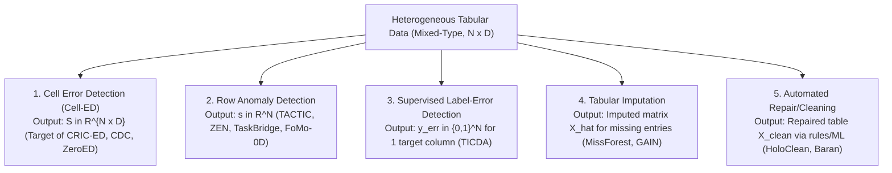

# Closest-Work Comparison Matrix & Novelty Analysis

> **Superseded comparisons, 2026-10-30:** this historical matrix contains unsupported
> universal claims and must not be copied into the current paper. The checked v2.1
> support record is `CITATION_AUDIT_20261030.md` and current prose is
> `paper/sections/related_work.tex`. CDC uses clean training/calibration in its evaluated
> setting; its universal failure without clean splits and “LOO calibration” are not
> established here. DDC's reference algorithm is not reproduced by DDCcore. TACTIC
> already studies contaminated contexts; broad contamination novelty is false.
> ZeroED's venue/latency and the remaining uninspected method claims below are not
> usable evidence. CRIC-ED v2.1 uses nested suspicion trimming, not influence estimation
> or a rare-valid protection guarantee. Raw TabPFN is not the reference uTabPFN extension.

**Worker:** W1-LIT (Literature & Novelty Specialist)  
**Worktree:** `C:/Users/ngoda/orca/workspaces/ACIIDS2027/literature`  
**Date:** 2026-10-29  
**Focus:** Ground-Truth Task Disambiguation & CRIC-ED Novelty Boundaries  

---

## 1. Disambiguation of 5 Neighboring Research Tasks

It is scientifically invalid to compare headline scores (e.g. AUROC vs AUPRC) across differing problem formulations as interchangeable state-of-the-art.

| Task Dimension | Cell Error Detection (Cell-ED) | Row Anomaly Detection | Label-Error Detection | Tabular Imputation |
| :--- | :--- | :--- | :--- | :--- |
| **Output Space** | Matrix $S \in \mathbb{R}^{N \times D}$ | Vector $s \in \mathbb{R}^N$ | Vector $y \in \{0, 1\}^N$ | Matrix $\hat{X} \in \mathbb{R}^{N \times D}$ |
| **Primary Metric** | Cell-level AUPRC, P@k, R@k | Row-level AUROC, F1 | Label-level Precision/Recall | RMSE (numeric), Acc (cat) |
| **Input State** | Full table with corrupted values | Full table with anomalous rows | Features $X$ + noisy label $y$ | Table with explicit NaNs |
| **Primary Prior Works** | CDC (2024), ZeroED (2025), ForestED (2026), DDC (2018) | TACTIC (2026), ZEN (2026), TaskBridge (2026), FoMo-0D (2024) | TICDA (2026), Confident Learning (2021) | MissForest (2012), HyperImpute (2022) |

---

## 2. Comprehensive Closest-Work Comparison Matrix

| System / Paper | Venue / Year | Task Scope | Backbone / Engine | Cross-Fitting / LOO? | Context Selection / Intervention | Key Limitation for Cell-ED under Dirty Context |
| :--- | :--- | :--- | :--- | :--- | :--- | :--- |
| **CDC** (Jäger et al.) | AISTATS 2024 | Cell-ED / Imputation | Pretrained Imputer + Conformal | Yes (LOO Calibration) | None (Assumes clean calibration set) | Fails when no clean calibration split exists; vulnerable to self-contamination. |
| **uTabPFN Extension** (PriorLabs) | Code 2025–2026 | Imputation & Row Anomaly | TabPFN v2 | Optional row masking | Naive random context sampling | Evaluates row/imputation likelihood; naive sampling suffers from context error normalization. |
| **TACTIC** (Preprint) | arXiv 2026-03 | Row Anomaly | TabPFN v1/v2 | No | Context noise ablation (row level) | Measures only row-level AUROC. Does not locate which cell within a row is corrupted. |
| **ZEN / FOCUS** (Preprint) | arXiv 2026-10 | Row Anomaly | Prior-Data Fitted Networks | Yes (Fold-out embeddings) | kNN Reference Embeddings | Focuses purely on row embeddings; lacks coordinate-wise conditional likelihood for mixed cells. |
| **TaskBridge** (Preprint) | arXiv 2026-09 | Row Anomaly | TabPFN / TabICL | No | Virtual ICL normality anchoring | Row-level only. Requires synthetic normality tasks that do not scale to $D$ heterogeneous feature conditional tasks. |
| **TICDA** (Preprint) | arXiv 2026-10 | Label Attribution | TabPFN / TabICL | No | Linear surrogate influence pruning | Designed strictly for supervised classification targets; cannot audit $N \times D$ cells without supervised labels. |
| **ZeroED** (Preprint/ICDE) | ICDE 2025 | Cell-ED | Large Language Model (Prompting) | N/A | Prompt demonstration selection | High latency ($>10$s per prompt), massive API cost, struggle on wide numeric continuous columns. |
| **ForestED** (Preprint) | arXiv 2025/2026 | Cell-ED | LLM-Induced Decision Trees | N/A | Tree ensemble pruning | Relies on LLM semantic rule mining; high compute overhead compared to training-free TFMs. |
| **DDC** (Rousseeuw et al.) | Technometrics 2018 | Cell-ED (Numeric only) | Robust correlation matrix & regression | Yes (Leave-cell-out) | None | Purely numerical; cannot model complex categorical associations or mixed multi-modal interactions. |
| **CRIC-ED** (This Work) | Proposal (ACIIDS 2027) | Unsupervised Cell-ED | TabPFN v2 / TabICL | **Strict Leave-Row-Out Cross-Fitting** | **Influence-Aware Context Trimming** | Investigates cell-level self-contamination and preserves rare-valid patterns. |

---

## 3. Rigorous Novelty Delta & Claim Audit

### Overlap & Non-Novel Areas (Must NOT be claimed as novel)
1. **"Using Tabular Foundation Models for Anomaly Scoring"**: **NOT NOVEL**. TabPFN v2 already natively includes unsupervised density and anomaly scoring extensions.
2. **"Leave-Row-Out Cross-Fitting"**: **NOT NOVEL**. Standard practice in statistical error detection (DDC 2018) and present in ZEN (2026) and CDC (2024). Cross-fitting is a **mandatory invariant**, not an invention.
3. **"Replacing Imputers with Foundation Models"**: **INCREMENTAL**. CDC already formalized the pipeline of imputation residuals; merely swapping the imputer with TabPFN is an insufficient scientific contribution.

### True Novelty Boundary (The Genuine Scientific Delta)
1. **Mechanistic Characterization of Cell-Level Self-Contamination:**
   While TACTIC (2026) demonstrated that contaminated context degrades row-level anomaly AUROC, no prior work has analyzed how structured cell corruptions (clustered typographical patterns, swapped column entities) distort the **conditional in-context density $P(X_j \mid X_{-j})$**, leading to the **Context Normalization** phenomenon at the coordinate level.
2. **Contamination-Resilient Context Intervention & Rare-Valid Control:**
   CRIC-ED contributes a training-free intervention that prunes high-leverage corrupted in-context exemplars while explicitly controlling for false alarms on **rare-valid subgroups** (minority records that appear anomalous due to scarcity rather than corruption).

---

## 4. Falsification & Fallback Triggers

If empirical pilot tests (Gate G2) reveal any of the following:
- Influence trimming does not outperform matched random context subsampling on cell AUPRC;
- Context trimming induces disproportionate false positives ($>25\%$ increase in FPR) on rare-valid categories;
- The inference runtime exceeds 5 seconds per row on CPU;

**The project must immediately pivot to:**
- **Fallback Framing 1 (CS-ED: Selective Abstention on Rare-Valid Cells):** Re-orient the manuscript around epistemic uncertainty estimation and knowing when to abstain rather than aggressive context pruning.
- **Fallback Framing 2 (Dual-ED: Coordinate Robust Numeric Deviance + LLM Semantic Verification):** Eliminate TFM backbone dependencies entirely.
